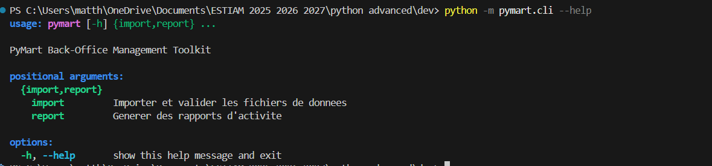
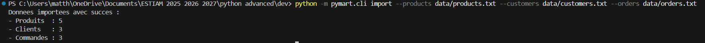
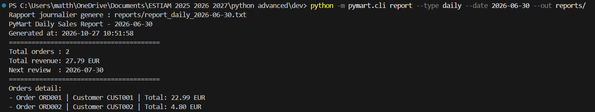
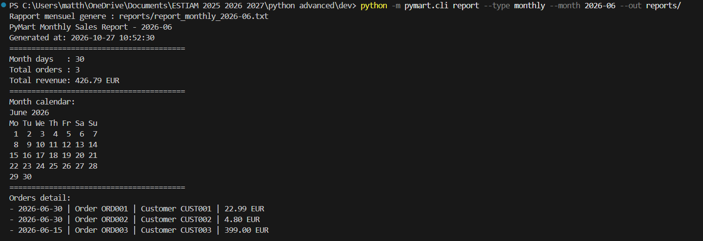
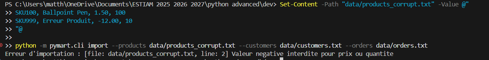

# Preuves d'exécution du projet PyMart

Ce document consigne les tests de bon fonctionnement de l'application en ligne de commande conformes au barème d'évaluation.

---

## 1. Menu d'aide de la CLI
Affichage des options et des sous-commandes disponibles :

---

## 2. Importation et validation des données
Lecture en streaming des fichiers et chargement sans erreur :

---

## 3. Rapport journalier
Génération sur disque avec calcul de l'échéance à +30 jours :

---

## 4. Rapport mensuel
Génération sur disque avec intégration du calendrier textuel :

---

## 5. Gestion robuste des erreurs
Interception d'une anomalie (prix négatif) avec indication du fichier et de la ligne, sans plantage du terminal :

